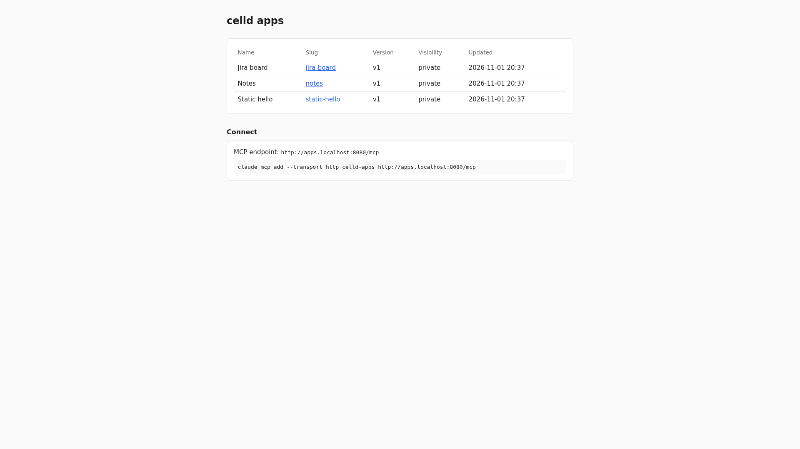

# celld apps

A self-hosted app platform built like Cloudflare Durable Objects. An agent creates
an app through an MCP connector, deploys static files, and optionally gives
it a private SQLite database. Each app gets its own subdomain. The platform is
an ordinary Cloudflare Workers project running on
[celld](https://github.com/denoland/celld) (Deno's open-source Durable Objects
runtime), with all state in a RustFS bucket.



## Usage

```bash
make docker-up                 # rustfs → bucket → deploy platform → celld
open http://apps.localhost:8080            # dashboard
claude mcp add --transport http celld-apps http://apps.localhost:8080/mcp
make e2e                       # 56 end-to-end checks, ~12 s
```

Examples left running by `make e2e`: <http://static-hello.apps.localhost:8080>,
<http://notes.apps.localhost:8080>, <http://jira-board.apps.localhost:8080>.
`*.localhost` resolves to loopback in Chrome, Firefox and curl, so no DNS is needed.
From the Mac, when the stack runs in an OrbStack VM, use `apps.<vm>.orb.local:8080`
(e.g. <http://apps.nomad.orb.local:8080>); add your VM's domain to `APPS_DOMAINS` in
`platform/wrangler.json`, then `make deploy`. Links follow the domain you came in on.

## Services

| Container | Port(s) | Description |
|---|---|---|
| **celld** | `8080` | Runs the platform worker: dashboard, `/mcp`, REST `/api`, every app on `{slug}.apps.localhost` |
| **rustfs** | `9000` (S3), `9001` (console, `rustfsadmin` / `rustfsadmin`) | Bucket `cells`: deployments, every Durable Object's SQLite, app files |
| **deploy** | – | One-shot `celld deploy` of `platform/`; `make deploy` pushes changes, no restart |
| **bucket-init** | – | One-shot bucket creation |

## How it works

| Piece | Where | What it holds |
|---|---|---|
| `Registry` Durable Object | `platform/src/registry.ts` | One instance: apps, slugs, visibility, versions |
| `AppHost` Durable Object | `platform/src/apphost.ts` | One per app: only that app's own SQLite data |
| R2 binding `files` | `apps/{id}/v{n}/…` in the bucket | Immutable files per version; deploy and rollback flip a pointer |
| App API | `{slug}.apps.localhost/_api/sql`, `/_api/schema`, `/_api/client.js` | What an app's frontend calls, same origin, relative URLs |
| Auth hook | `platform/src/auth.ts` | `identify()` + `canView()`; `AUTH_MODE=none` today |

MCP tools: `create_app`, `deploy`, `get_upload_url`, `db_query`, `db_import`,
`db_schema`, `list_apps`, `get_app`, `rollback`, `set_visibility`, `delete_app`.

## Notes

- **No auth, no TLS.** Visibility is stored but not enforced until an auth mode is implemented in `auth.ts`.
- **celld's SQLite authorizer blocks `PRAGMA …` and `AUTOINCREMENT`.** Use `pragma_table_info()` and plain `INTEGER PRIMARY KEY`.
- **Each Durable Object's SQLite also contains `_cf_*` and `_litestream_*` tables**; `schema()` hides them.
- **Single node:** every write waits for the bucket upload. Fine locally; run 2+ celld nodes if write latency matters.
- **Port 8081 (celld internal) is unauthenticated**; it is deliberately not published.
- **Renaming the worker in `wrangler.json` creates a second deployment** in the bucket rather than replacing the first. Run `make reset` after a rename.
- **Seed SQL runs only when the app has no tables**, so a redeploy never overwrites data.
- **Reset:** `make reset` (deletes `.docker/`).
