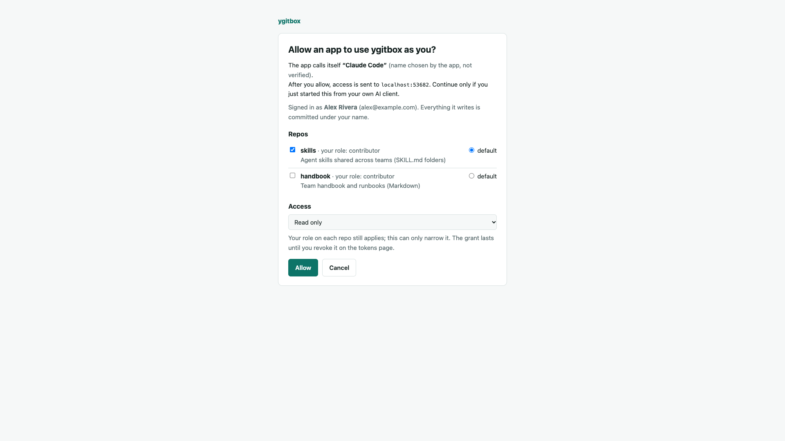
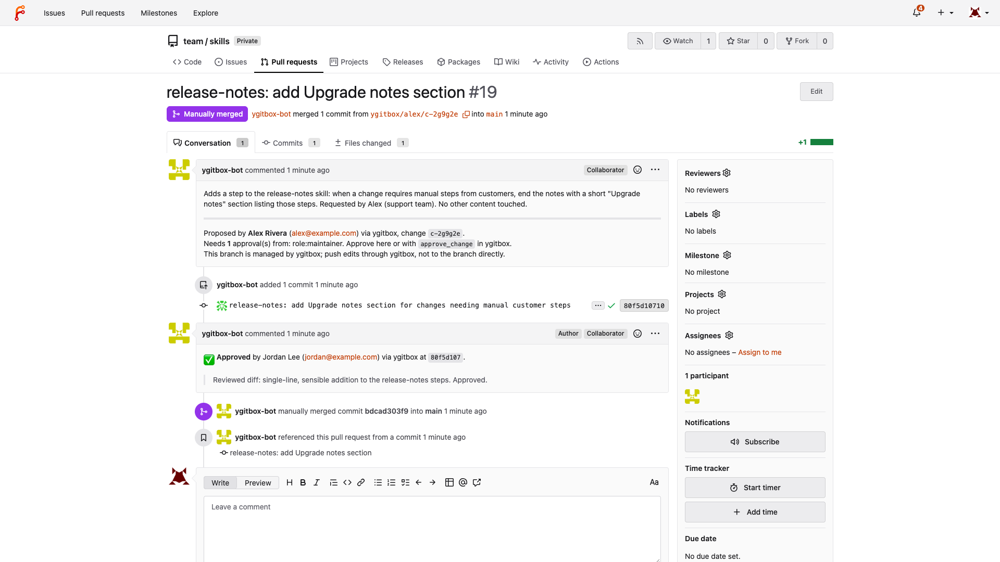

# ynfra / ygitbox

MCP server that lets people read and change Git repos from their AI client
without a Git account: they sign in with SSO or a token, a single service user
does the Git work, every commit is authored as the real person, and per-path
policy decides whether a write lands directly or as a pull request that needs
approval. This stack is the local POC with Forgejo as both the Git server and
the stand-in SSO.



## Usage

```bash
make up          # boots Forgejo, seeds users/repos/tokens (idempotent), builds + starts ygitbox
make e2e         # 102 end-to-end checks through a real MCP client
cd app && bun run test/oauth.ts   # full OAuth flow: DCR → PKCE → SSO → consent → refresh
cd app && YGITBOX_DATA_DIR=$(mktemp -d) bun test test/unit.test.ts   # policy + approval logic
make token EMAIL=alex@example.com NAME="Alex Rivera" LEVEL=propose   # personal access token
```

Add it to Claude Code with OAuth (a browser opens for SSO + consent):

```bash
claude mcp add --transport http ygitbox http://localhost:8790/mcp
```

Or with a token:

```json
{ "mcpServers": { "ygitbox": { "type": "http", "url": "http://localhost:8790/mcp",
  "headers": { "Authorization": "Bearer ygb_pat_…", "X-MCP-Tools-Except": "review" } } } }
```

Demo users (password `ygitbox-demo`): `alex`, `sam` (no Git access, SSO only),
`jordan` (maintainer), `forgeadmin` (admin). Forgejo UI: http://localhost:3300.

## Tools

| Tool | Group | Access | Description |
|---|---|---|---|
| `whoami`, `list_repos`, `get_policy` | account | read | Identity, repos, what a write to a path will do |
| `list_files`, `read_file`, `search_files` | files | read | Browse main or any change (`ref: "c-…"`); denied paths hidden |
| `write_file`, `edit_file`, `move_file`, `delete_file` | files | propose | Into a change, or straight to main where policy says `direct` |
| `start_change`, `list_changes`, `get_change`, `get_change_diff`, `update_change`, `submit_change`, `comment_change`, `withdraw_change` | changes | read / propose | A change = one branch = one pull request |
| `approve_change`, `request_changes`, `merge_change`, `reject_change` | review | review | Approval pinned to `head_sha`; never your own change |
| `list_commits`, `get_commit`, `revert_commit` | history | read / propose | Real authors; revert opens a change |
| `list_skills`, `get_skill`, `create_skill`, `update_skill`, `validate_skill`, `delete_skill` | skills | read / propose | Typed tools over `skills/<name>/SKILL.md` with lint |

## Ports

| Service | Port | Description |
|---|---|---|
| ygitbox | 8790 | MCP at `/mcp`, OAuth at `/oauth/*`, token page at `/tokens` |
| Forgejo | 3300 | Git server, pull requests, and the OIDC login for this POC |

## Notes

- First run needs `make up`, not plain `docker compose up`: the bootstrap writes `.docker/ygitbox.env` (bot token, OAuth client).
- Reset everything with `make reset`; the e2e suite is re-runnable but leaves its commits in the demo repos.
- Policy lives in each repo at `.ygitbox/policy.yaml` and is never writable through ygitbox itself. A broken policy fails closed.
- Native Forgejo reviews count only for logins mapped under `native_reviewers` in `repos.yaml`.
- Only Forgejo is implemented as a provider; GitHub and GitLab need just `providers/types.ts` (PR bookkeeping), since all Git work is plain `git`.



See [AGENTS.md](AGENTS.md) for conventions, internals, and day-2 operations.
